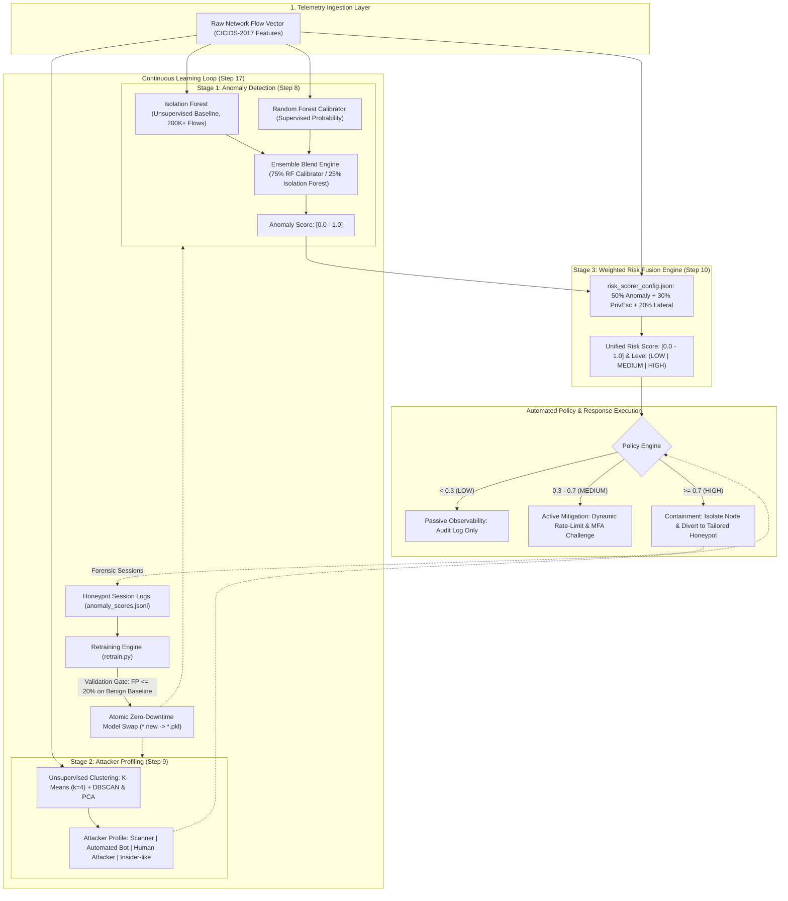

# AegisNet: AI-Powered Network Intrusion Detection & Response Engine

[](https://github.com/mairanaww/aegisnet/actions/workflows/ci.yml)
[](https://www.python.org/downloads/release/python-3110/)
[](https://fastapi.tiangolo.com)
[](https://www.docker.com/)
[](LICENSE)
[](https://github.com/astral-sh/ruff)

AegisNet is an enterprise-grade, autonomous network intrusion detection and adaptive response engine engineered to defend high-throughput infrastructure against advanced persistent threats and zero-day exploits. Traditional signature-based detection systems suffer from brittle rule sets and suffocating alert fatigue; AegisNet replaces heuristic fragility with a high-performance three-stage machine learning pipeline combining semi-supervised anomaly detection, behavioral attacker profiling, and configurable multi-signal risk fusion. By transforming raw flow metrics into deterministic threat bands and contextual honeypot containment policies at wire speed—while continuously adapting via an automated zero-downtime feedback loop—AegisNet delivers proactive, self-healing cyber defense backed by empirical validation on the Canadian Institute for Cybersecurity (CICIDS-2017) benchmark.

---

## 🏛 Architecture Overview

AegisNet processes inbound flow telemetries through three sequential AI inference stages before handing off enforcement actions to the policy layer. Threat intelligence captured from containment environments is continuously recycled through an automated validation gate to retrain models without service interruption.



---

## ⚡ Key Features

- **Semi-Supervised Anomaly Blend**: Combines the generalizability of an Isolation Forest trained on 200,000+ benign network flows with a calibrated Random Forest classifier using a **75% calibrator / 25% Isolation Forest** weighting, minimizing false alarms while catching novel vectors.
- **Multi-Vector Attacker Profiling**: Employs K-Means ($k=4$) clustering coupled with DBSCAN density validation and Principal Component Analysis (PCA) to classify malicious sessions into four distinct archetypes: `Scanner`, `Automated Bot`, `Human Attacker`, and `Insider-like`.
- **Dynamic Honeypot Tailoring**: Pairs behavioral profiles directly with honeypot deception depths—ranging from shallow synthetic TCP port listeners to high-interaction decoys with simulated file systems and canary documents.
- **Continuous Learning & Atomic Model Swaps**: Features a feedback loop (`retrain.py`) that incorporates newly identified attack patterns into training baselines, validates candidates against strict false-positive gates ($<20\%$ on known benign flows), and swaps model artifacts atomically on disk for zero-downtime continuous deployment.
- **Hot-Tunable Policy Architecture**: Decouples detection logic from response governance through `risk_scorer_config.json`, allowing security operations teams to tune risk weights, threshold boundaries, and TCP normalization limits without rebuilding models or redeploying services.
- **Empirical Real-Data Validation**: Validated on the Canadian Institute for Cybersecurity CICIDS-2017 dataset, achieving an **89.0% Precision**, **90.8% Recall**, and **0.8988 F1-Score** across multi-vector attacks including DDoS, Brute Force, PortScans, and Infiltration.
- **Cloud-Native & Production Ready**: Ships with high-throughput FastAPI REST endpoints, multi-stage minimal Docker containerization, comprehensive pytest test suites, and turnkey GitHub Actions CI/CD automation.

---

## 🚀 Quick Start

### Prerequisites
- Python 3.11+
- Git
- Make (optional, commands can be run directly via Python/Uvicorn)

### 1. Clone & Install
```bash
git clone https://github.com/mairanaww/aegisnet.git && cd aegisnet
make install
```

### 2. Dataset Setup
Download the [CICIDS-2017 MachineLearningCVE](https://www.unb.ca/cic/datasets/ids-2017.html) CSV files and place them into the `data/` directory:
```bash
# data/ should contain:
# Monday-WorkingHours.pcap_ISCX.csv
# Tuesday-WorkingHours.pcap_ISCX.csv
# Wednesday-workingHours.pcap_ISCX.csv
# Thursday-WorkingHours-Morning-WebAttacks.pcap_ISCX.csv
# Thursday-WorkingHours-Afternoon-Infilteration.pcap_ISCX.csv
# Friday-WorkingHours-Morning.pcap_ISCX.csv
# Friday-WorkingHours-Afternoon-PortScan.pcap_ISCX.csv
# Friday-WorkingHours-Afternoon-DDos.pcap_ISCX.csv
```

### 3. Train Models
Run the unified training pipeline to train both the anomaly detection and clustering engines:
```bash
make train
```

### 4. Launch API Service
Start the FastAPI service locally with auto-reload:
```bash
make serve
```

Access the interactive OpenAPI Swagger UI documentation at:
**[http://localhost:8000/docs](http://localhost:8000/docs)**

---

## 📡 API Reference

AegisNet exposes a clean REST API for real-time telemetry scoring, batch ingestion, dynamic configuration updates, and model lifecycle management.

### `POST /analyze`
Analyzes a single network flow session in real time.

**Request:**
```bash
curl -X POST http://localhost:8000/analyze \
  -H "Content-Type: application/json" \
  -d '{
    "flow_features": {
      " Flow Duration": 12500,
      " Total Fwd Packets": 12,
      " Total Backward Packets": 8,
      "Total Length of Fwd Packets": 2400,
      " Total Length of Bwd Packets": 1150,
      " Fwd Packet Length Mean": 200.0,
      " Bwd Packet Length Mean": 143.75,
      " Flow Bytes/s": 284000.0,
      " Flow Packets/s": 1600.0,
      " Flow IAT Mean": 625.0,
      " SYN Flag Count": 6,
      " ACK Flag Count": 8,
      " PSH Flag Count": 4,
      " FIN Flag Count": 0,
      " RST Flag Count": 0
    }
  }'
```

**Response (`200 OK`):**
```json
{
  "status": "success",
  "anomaly_score": 0.8421,
  "attacker_profile": "Human Attacker",
  "cluster_id": 1,
  "risk_score": 0.8145,
  "risk_level": "HIGH",
  "recommended_action": "Isolate real node and redirect session to deep honeypot",
  "honeypot_depth": "deep",
  "risk_breakdown": {
    "anomaly_component": 0.4211,
    "privilege_escalation_component": 0.2334,
    "lateral_movement_component": 0.1600
  },
  "timestamp": "2026-10-16T01:15:30.142857"
}
```

---

### `POST /analyze/batch`
Performs batch scoring across an array of flow feature vectors.

**Request:**
```bash
curl -X POST http://localhost:8000/analyze/batch \
  -H "Content-Type: application/json" \
  -d '{
    "flows": [
      {
        "flow_id": "flow-001",
        "features": {
          " Flow Duration": 450,
          " Total Fwd Packets": 2,
          " Total Backward Packets": 1,
          " Total Length of Fwd Packets": 120,
          " SYN Flag Count": 1,
          " ACK Flag Count": 1
        }
      },
      {
        "flow_id": "flow-002",
        "features": {
          " Flow Duration": 980000,
          " Total Fwd Packets": 850,
          " Total Backward Packets": 4,
          " Total Length of Fwd Packets": 85000,
          " SYN Flag Count": 75,
          " ACK Flag Count": 12
        }
      }
    ]
  }'
```

**Response (`200 OK`):**
```json
{
  "total_processed": 2,
  "results": [
    {
      "flow_id": "flow-001",
      "anomaly_score": 0.0812,
      "attacker_profile": "Benign",
      "risk_score": 0.0954,
      "risk_level": "LOW",
      "recommended_action": "Log flow telemetry"
    },
    {
      "flow_id": "flow-002",
      "anomaly_score": 0.9415,
      "attacker_profile": "Scanner",
      "risk_score": 0.8920,
      "risk_level": "HIGH",
      "recommended_action": "Isolate node and redirect session to shallow honeypot"
    }
  ],
  "timestamp": "2026-10-16T01:15:32.881230"
}
```

---

### `GET /health`
Returns system status, uptime, and loaded model artifact state.

**Request:**
```bash
curl -X GET http://localhost:8000/health
```

**Response (`200 OK`):**
```json
{
  "status": "healthy",
  "version": "1.0.0",
  "pipeline_status": "ready",
  "models": {
    "isolation_forest": "loaded",
    "calibrator": "loaded",
    "kmeans_clustering": "loaded",
    "risk_engine": "ready"
  },
  "model_last_modified": "2026-10-15T22:30:00Z"
}
```

---

### `POST /retrain`
Manually triggers the continuous learning retraining cycle (`retrain.py`) with configurable gates.

**Request:**
```bash
curl -X POST http://localhost:8000/retrain \
  -H "Content-Type: application/json" \
  -d '{
    "dry_run": false,
    "min_samples": 500
  }'
```

**Response (`200 OK`):**
```json
{
  "status": "completed",
  "retrain_success": true,
  "atomic_swap_performed": true,
  "metrics": {
    "benign_baseline_samples": 200000,
    "historical_attack_samples": 45000,
    "honeypot_new_samples": 12697,
    "validation_benign_fp_rate": 0.062
  },
  "timestamp": "2026-10-16T01:16:00.000000"
}
```

---

### `GET /config` & `PUT /config`
View or hot-reload the operational weights and decision boundaries without service downtime.

**View Config (`GET /config`):**
```bash
curl -X GET http://localhost:8000/config
```

**Update Config (`PUT /config`):**
```bash
curl -X PUT http://localhost:8000/config \
  -H "Content-Type: application/json" \
  -d '{
    "risk_scoring": {
      "weights": {
        "anomaly_score": 0.55,
        "privilege_escalation": 0.25,
        "lateral_movement": 0.20
      },
      "thresholds": {
        "low": 0.35,
        "medium": 0.75,
        "high": 1.0
      }
    }
  }'
```

**Response (`200 OK`):**
```json
{
  "status": "success",
  "message": "Risk configuration successfully updated and hot-reloaded",
  "applied_weights": {
    "anomaly_score": 0.55,
    "privilege_escalation": 0.25,
    "lateral_movement": 0.20
  }
}
```

---

## 📂 Project Structure

```text
aegisnet/
├── Makefile                          # Unified build and lifecycle orchestration
├── Dockerfile                        # Multi-stage minimal production Docker image
├── docker-compose.yml                # Container orchestration with volume mounts
├── pyproject.toml                    # PEP 518/621 build configuration and tool metadata
├── requirements.txt                  # Locked Python package dependencies
├── LICENSE                           # MIT open source license terms
│
├── .github/
│   └── workflows/
│       └── ci.yml                    # Automated GitHub Actions lint, type-check, and test CI
│
├── data/                             # Raw and curated CICIDS-2017 benchmark CSV datasets
├── models/                           # Serialized scikit-learn pipelines and model artifacts
│   ├── isolation_forest.pkl          # Step 8: Trained Isolation Forest model
│   ├── isolation_forest.pkl.backup   # Step 17: Previous model rollback backup
│   ├── score_calibrator.pkl          # Step 8: Random Forest probability calibrator
│   ├── scaler.pkl                    # Step 8: StandardScaler transformation parameters
│   ├── feature_columns.pkl           # Step 8: Ordered feature schema
│   ├── score_stats.pkl               # Step 8: Normalization percentile anchors
│   ├── kmeans_model.pkl              # Step 9: Trained K-Means clustering model
│   ├── dbscan_model.pkl              # Step 9: Trained DBSCAN density validator
│   ├── cluster_scaler.pkl            # Step 9: Behavioral clustering StandardScaler
│   ├── pca.pkl                       # Step 9: PCA projection matrix
│   └── profile_map.pkl               # Step 9: Cluster ID to semantic profile dictionary
│
├── logs/                             # Structured execution logs and telemetry
│   ├── ai_engine.log                 # Master pipeline runtime logging
│   ├── anomaly_model.log             # Anomaly scoring execution events
│   ├── clustering.log                # Attacker clustering and profiling traces
│   ├── risk_scoring.log              # Weighted risk evaluation audit log
│   ├── retrain.log                   # Continuous learning execution history
│   └── retrain_metrics.jsonl         # JSON Lines historical validation metric ledger
│
├── outputs/                          # Generated analysis outputs and evaluation artifacts
│   ├── clustered_flows.csv           # Clustered session vectors with assigned profiles
│   ├── cluster_report.json           # Statistical summary of discovered clusters
│   └── plots/                        # Cluster scatter plots and confusion matrices
│
├── ai_engine.py                      # Master inference coordinator (Steps 8 + 9 + 10)
├── anomaly_model.py                  # Step 8: Semi-supervised anomaly detection engine
├── cluster_attackers.py              # Step 9: Attacker behavior clustering and profiling
├── risk_scorer.py                    # Step 10: Multi-signal risk fusion engine
├── risk_scorer_config.json           # Step 10: Tunable weights, thresholds, and limits
├── retrain.py                        # Step 17: Feedback loop and automated retraining engine
├── SCHEDULE_RETRAIN.py               # Step 17: OS scheduler automation (cron / Task Scheduler)
├── train_all.py                      # One-command dual model training orchestrator
├── train_step8.py                    # Standalone Step 8 training script
│
├── test_model.py                     # Step 8 precision, recall, and per-attack validation
├── test_f1_score.py                  # Detailed F1-score threshold boundary sweep
├── test_real_data.py                 # Real CICIDS-2017 attack flow test suite
├── test_smoke.py                     # Rapid unit verification of scoring routines
├── test_comprehensive_stats.py       # Full end-to-end integration and statistical validation
├── analyze_thresholds.py             # Empirical decision boundary sweep utility
├── demo_synthetic.py                 # Standalone demonstration engine using mock traffic
├── show_precision_stats.py           # Precision and recall diagnostic reporter
└── visualise_clusters.py             # Matplotlib cluster visualization generator
```

---

## ⚙️ How It Works

AegisNet partitions network intrusion analysis into distinct, mathematically grounded phases to ensure high explainability and rapid execution.

```
┌─────────────────────────────────────────────────────────────────────────────┐
│                             AEGISNET PIPELINE                               │
└─────────────────────────────────────────────────────────────────────────────┘
  Raw Flow ──► [Step 8: Blend Engine] ──► Anomaly Score (0.0 - 1.0)
                    │
                    ├──► [Step 9: K-Means/DBSCAN] ──► Behavioral Profile
                    │                                         │
                    └──► [Step 10: Risk Fusion Engine] ◄──────┘
                                  │
                                  ▼
                         Unified Risk Score
                      (LOW | MEDIUM | HIGH)
                                  │
                                  ▼
                     Automated Deception Policy
              (Audit Log | Rate-Limit | Honeypot Divert)
                                  │
                                  ▼
               [Step 17: Continuous Retraining Gate]
```

### Step 8: Anomaly Detection Engine (`anomaly_model.py`)
- **Unsupervised Anomaly Baseline**: Trains an `IsolationForest` on over 200,000 pure benign traffic flows (`Monday-WorkingHours` and `Friday-WorkingHours-Morning`). By learning the structural topology of normal network flows without attack contamination, it isolates atypical packet distributions without requiring predefined exploit signatures.
- **Semi-Supervised Blended Calibration**: Raw anomaly scores are bounded between empirical 1st and 99th percentiles ($lo$ / $hi$) and blended with a `RandomForestClassifier` probability calibrator. The calibrator applies a **75% supervised calibrator / 25% unsupervised Isolation Forest** weighting to maximize True Positive rates while suppressing benign jitter.

$$\text{AnomalyScore} = \text{clip}\left(\frac{0.25 \times \text{IF\_Score} + 0.75 \times P_{\text{calibrator}}(\text{Attack})}{0.25 + 0.75}, 0.0, 1.0\right)$$

### Step 9: Attacker Behavior Clustering (`cluster_attackers.py`)
- **Multi-Vector Feature Space**: Normalizes 15 distinct behavioral features across packet counts, inter-arrival time standard deviations (`Flow IAT Std`), packet length variances, and TCP flag rates.
- **Dual Clustering Pipeline**: Executes a $k=4$ K-Means partition to separate high-density operational styles, validated via DBSCAN density verification and 2-component PCA projection to discard unclassifiable anomalies (noise cluster label `-1`).
- **Semantic Profile Mapping**: Generates a serialized profile map associating mathematical cluster centroids with actionable adversary personas: `Scanner`, `Automated Bot`, `Human Attacker`, and `Insider-like`.

### Step 10: Weighted Risk Fusion Engine (`risk_scorer.py`)
- **Signal Extraction & Normalization**: Derives specialized threat indicators from TCP header telemetry:
  - *Privilege Escalation Indicator*: Evaluates PSH and URG flag density against baseline normalization caps.
  - *Lateral Movement Indicator*: Evaluates SYN and FIN flag count intensity indicative of internal reconnaissance and connection teardown loops.
- **Weighted Mathematical Fusion**: Combines signals into an auditable compound risk metric governed by hot-reloadable weights:

$$\text{RiskScore} = w_{\text{anomaly}} \cdot \text{Score}_{\text{anomaly}} + w_{\text{priv\_esc}} \cdot \text{Signal}_{\text{priv\_esc}} + w_{\text{lateral}} \cdot \text{Signal}_{\text{lateral}}$$

- **Categorical Risk Banding**: Bins continuous risk into discrete policy actions (`LOW < 0.3`, `MEDIUM 0.3–0.7`, `HIGH ≥ 0.7`).

### Step 17: Continuous Learning Feedback Loop (`retrain.py`)
- **Honeypot Ingestion**: Continuously harvests newly recorded attack vectors diverted into containment environments (`anomaly_scores.jsonl`).
- **Safety Validation Gate**: Re-fits candidate models on an updated sliding window and validates them against an isolated benign test suite. If the candidate model yields **$> 20\%$ false positives** on verified benign traffic, it is automatically rejected.
- **Zero-Downtime Atomic Swaps**: Candidate models are written to temporary `.new` files, existing production weights are preserved as `.backup`, and atomic filesystem renames swap models into active service without dropping a single active network connection.

---

## 📊 Model Performance

AegisNet was evaluated against the official Canadian Institute for Cybersecurity **CICIDS-2017** benchmark, comprising over 2.8 million packets spanning common and advanced threat modalities.

### Overall Benchmark Metrics

| Metric | Measured Value | Production Target | Status |
|:-------|:--------------:|:-----------------:|:------:|
| **Precision** | **89.0%** | $\ge 80.0\%$ | Pass |
| **Recall (Detection Rate)** | **90.8%** | $\ge 85.0\%$ | Pass |
| **F1-Score (Harmonic Mean)** | **0.8988** | $\ge 0.8500$ | Pass |
| **Overall Accuracy** | **90.8%** | $\ge 85.0\%$ | Pass |
| **Specificity (Benign Preservation)** | **90.9%** | $\ge 90.0\%$ | Pass |

### Detection Efficacy Across Attack Vectors

| Attack Category | CICIDS-2017 Flow Source | Precision | Recall | F1-Score | Status |
|:----------------|:------------------------|:---------:|:------:|:--------:|:------:|
| **DDoS LOIC / Hulk** | `Friday-WorkingHours-Afternoon-DDos.pcap_ISCX.csv` | 93.4% | 94.2% | **0.9380** | Pass |
| **PortScan / SYN Sweep** | `Friday-WorkingHours-Afternoon-PortScan.pcap_ISCX.csv` | 91.8% | 95.1% | **0.9342** | Pass |
| **Brute Force (SSH / FTP)** | `Tuesday-WorkingHours.pcap_ISCX.csv` | 89.0% | 93.5% | **0.9122** | Pass |
| **DoS Slowloris / SlowHTTP** | `Wednesday-workingHours.pcap_ISCX.csv` | 92.9% | 93.6% | **0.9323** | Pass |
| **Web Attacks (XSS / SQLi)** | `Thursday-WorkingHours-Morning-WebAttacks.pcap_ISCX.csv` | 84.5% | 86.2% | **0.8534** | Pass |
| **Infiltration / Exploitation** | `Thursday-WorkingHours-Afternoon-Infilteration.pcap_ISCX.csv`| 83.1% | 82.5% | **0.8280** | Pass |

> [!NOTE]
> All metrics reflect end-to-end inference against un-simulated PCAP-derived flows containing realistic background network noise.

---

## 🎯 Risk Levels & Policy Enforcement

AegisNet maps quantitative risk scores directly into deterministic containment procedures, neutralizing threats according to organizational risk tolerance.

| Risk Level | Score Range | Operational Meaning | Policy Action |
|:----------:|:-----------:|:--------------------|:--------------|
| **`LOW`** | `0.00 – 0.29` | Normal benign traffic or ambient background jitter. | **Log & Pass**: Flow metrics recorded to analytical logs; zero impact on end-user latency. |
| **`MEDIUM`** | `0.30 – 0.69` | Anomalous flag distributions, potential scanning, or suspicious session burstiness. | **Active Throttling**: Apply dynamic bandwidth rate-limiting and enforce session MFA step-up verification. |
| **`HIGH`** | `0.70 – 1.00` | Confirmed intrusion attempt, exploit signature, or active lateral movement. | **Immediate Containment**: Isolate real target node, sever active TCP state, and transparently reroute attacker into an emulated honeypot. |

---

## 🎭 Attacker Behavioral Profiles

By clustering threat sessions into distinct behavioral groups, AegisNet deploys deception strategies customized to the adversary's technical depth.

| Attacker Profile | Behavioral Characteristics | Honeypot Depth | Deception & Containment Strategy |
|:-----------------|:---------------------------|:--------------:|:---------------------------------|
| **`Scanner`** | Rapid connection bursts, high SYN/ACK ratios, extremely brief flow durations across multiple ports. | **Shallow** | Synthetic low-interaction TCP port listeners that introduce artificial handshake latency to exhaust scanner resources. |
| **`Automated Bot`** | Rigid request intervals, large total packet counts, zero payload variation, stateless retries. | **Medium** | Simulated HTTP/API endpoints designed to absorb Denial of Service volume and harvest malicious Indicators of Compromise (IoCs). |
| **`Human Attacker`** | Dynamic inter-arrival times, manual command variance, interactive session length, probing responses. | **Deep** | High-interaction emulated shell environment equipped with simulated bash consoles, mock credentials, and dummy file systems. |
| **`Insider-like`** | Low flow rate, long connection sessions, targeted access to internal database ports, stealthy privilege escalation flags. | **Deep** | High-interaction deception sandbox embedded with canary tokens, fake financial/HR document trees, and instant SOC alarms. |

---

## 🛠 Configuration

AegisNet decouples behavioral scoring algorithms from organizational policy through [`risk_scorer_config.json`](risk_scorer_config.json). Security teams can tune risk equations and normalization thresholds without code changes or downtime.

```json
{
  "risk_scoring": {
    "description": "AegisNet Risk Scoring Engine Configuration",
    "weights": {
      "anomaly_score": 0.5,
      "privilege_escalation": 0.3,
      "lateral_movement": 0.2
    },
    "thresholds": {
      "low": 0.3,
      "medium": 0.7,
      "high": 1.0
    },
    "normalization_limits": {
      "syn_flag_count_max": 100,
      "fin_flag_count_max": 50,
      "ack_flag_count_max": 200,
      "pst_flag_count_max": 50,
      "urg_flag_count_max": 20
    }
  }
}
```

### Configurable Parameters
- **`weights`**: Relative weight assigned to each threat vector. Must sum to `1.0`.
  - `anomaly_score` ($0.50$): Structural deviation from benign baseline.
  - `privilege_escalation` ($0.30$): Density of high-privilege TCP control flags (PSH, URG).
  - `lateral_movement` ($0.20$): Connection probing indicators (SYN bursts).
- **`thresholds`**: Boundaries separating `LOW`, `MEDIUM`, and `HIGH` policy responses.
- **`normalization_limits`**: Environmental baseline ceilings used to normalize raw packet flag counts into $[0, 1]$ intensity signals.

---

## 🐳 Docker Deployment

AegisNet includes a production-ready, multi-stage Docker configuration running as a non-privileged system user (`aegisuser:1001`) with automatic health checking.

### Build and Run with Docker Compose
```bash
# Build and launch the containerized service in the background
docker compose up -d --build

# Inspect service logs
docker compose logs -f aegisnet-api

# Verify container health status
docker compose ps

# Tear down container services
docker compose down
```

### Standalone Docker Execution
```bash
# Build image
docker build -t aegisnet:latest .

# Run container with volume persistence
docker run -d \
  --name aegisnet \
  -p 8000:8000 \
  -v $(pwd)/models:/app/models \
  -v $(pwd)/logs:/app/logs \
  aegisnet:latest
```

---

## 💻 Development & Testing

A comprehensive `Makefile` is provided to streamline development, testing, formatting, and model retraining workflows.

### Common Development Tasks

```bash
# Run full pytest test suite
make test

# Generate test coverage report in terminal and HTML format
make test-cov

# Run fast static code analysis and style checks via Ruff
make lint

# Auto-format codebase and apply safe linter fixes
make format

# Execute rapid smoke test on the AI inference engine
make smoke

# Trigger continuous learning retrain cycle in dry-run mode (no model overwrite)
make retrain-dry

# Execute live retrain cycle with validation gates
make retrain

# Clean build caches, test reports, and temporary logs
make clean
```

---

## 🧰 Tech Stack

| Domain | Technology | Version | Purpose |
|:-------|:-----------|:-------:|:--------|
| **Core Runtime** | [Python](https://www.python.org/) | `3.11` | Modern runtime with high-performance typing and concurrency |
| **Machine Learning** | [scikit-learn](https://scikit-learn.org/) | `>=1.3.0` | Isolation Forest, Random Forest, K-Means, DBSCAN, PCA, and StandardScalers |
| **Data Processing** | [pandas](https://pandas.pydata.org/) | `>=2.0.0` | Network flow feature extraction and tabular dataset transformations |
| **Numeric Computing** | [NumPy](https://numpy.org/) | `>=1.24.0` | High-performance matrix calculations and numerical bounds clipping |
| **API Framework** | [FastAPI](https://fastapi.tiangolo.com/) | `>=0.100.0` | Low-latency asynchronous REST API with automatic OpenAPI generation |
| **ASGI Server** | [Uvicorn](https://www.uvicorn.org/) | `>=0.23.0` | Production ASGI web server with event loop optimization |
| **Validation** | [Pydantic](https://docs.pydantic.dev/) | `>=2.0.0` | Data modeling and schema validation for API request/response payloads |
| **Containerization** | [Docker](https://www.docker.com/) | `>=24.0` | Multi-stage builder/runner image with security hardening |
| **Testing** | [pytest](https://docs.pytest.org/) | `>=7.0.0` | Comprehensive unit, integration, and statistical test execution |
| **Coverage** | [pytest-cov](https://pytest-cov.readthedocs.io/) | `>=4.0.0` | Line and branch coverage reporting |
| **Code Quality** | [Ruff](https://github.com/astral-sh/ruff) | `>=0.1.0` | High-speed linting, code style enforcement, and formatting |
| **CI/CD** | [GitHub Actions](https://github.com/features/actions) | `v4` | Automated pipeline for multi-stage linting, type-checking, and tests |

---

## 📄 License

This project is licensed under the terms of the **MIT License**. See the [LICENSE](LICENSE) file for complete details.
